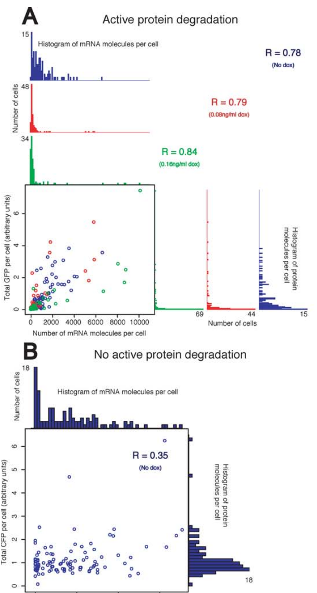
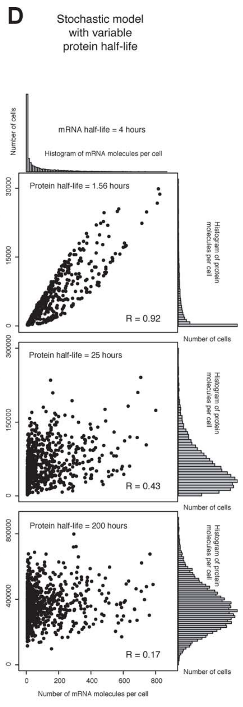
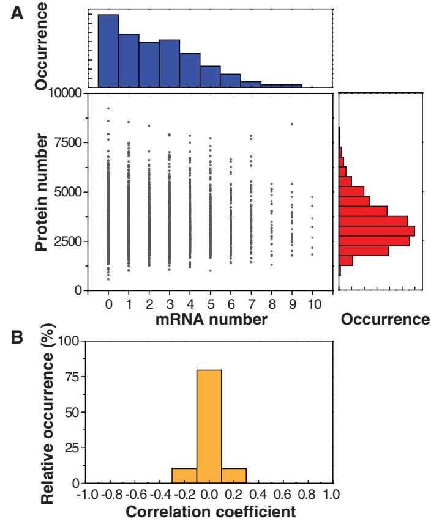
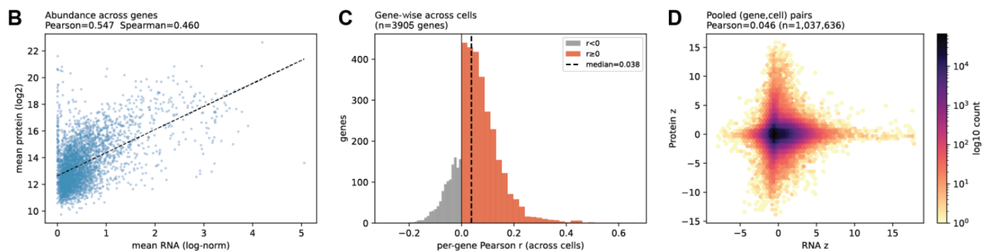
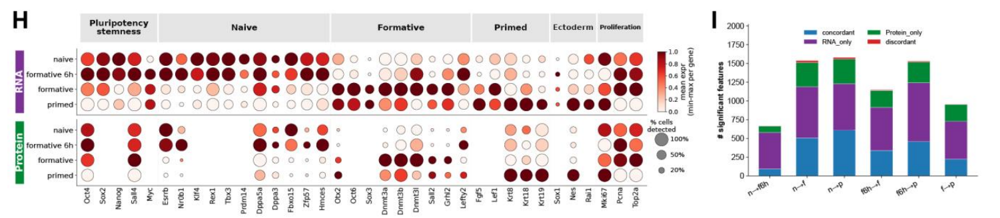
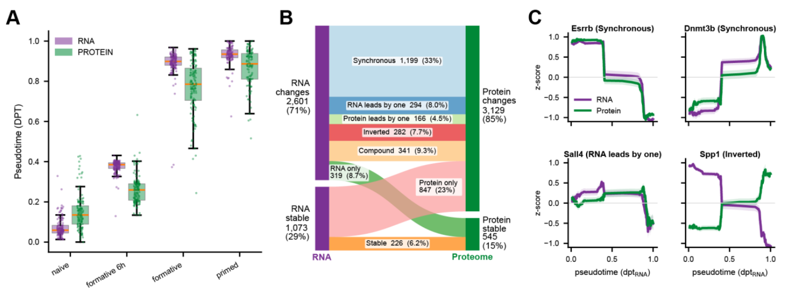
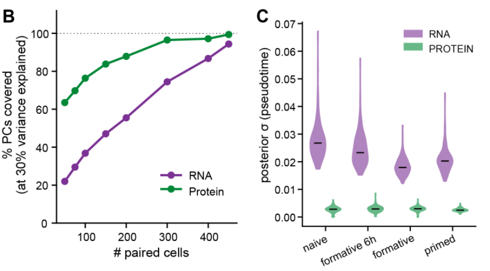
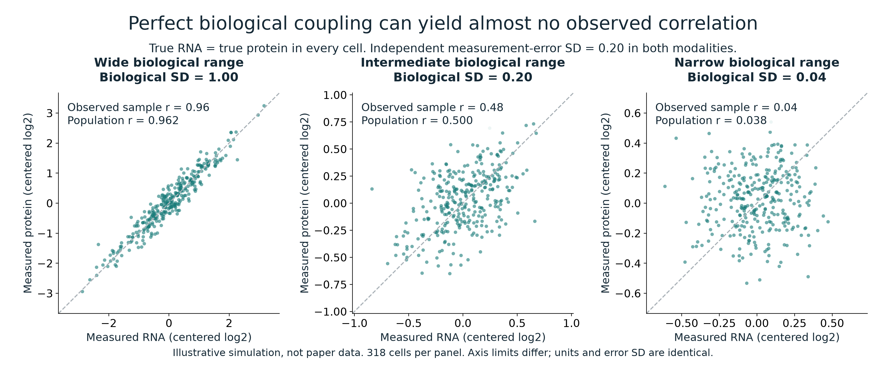
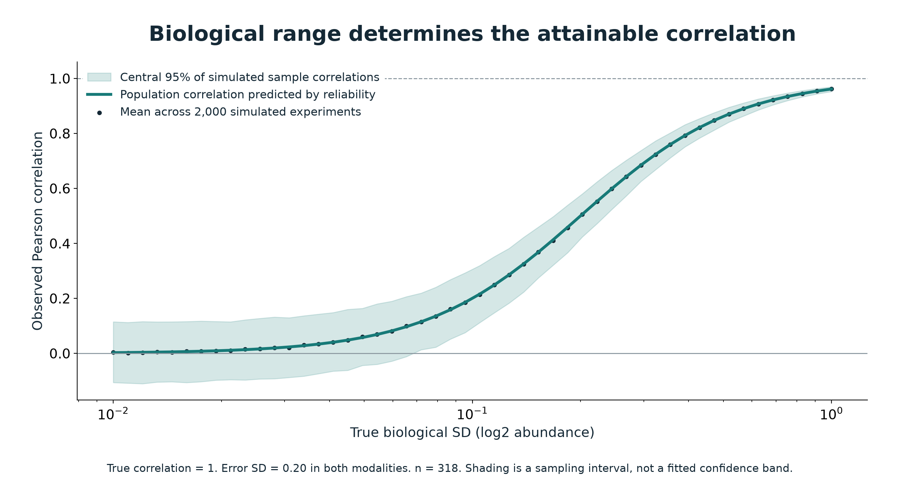

## Three different RNA–protein correlations

:::: {.columns}
::: {.column width="33%"}

Across genes

One point = one gene\
Are abundant RNAs associated with abundant proteins?
:::
::: {.column width="33%"}

Across cells

One point = one cell\
For a fixed gene, do RNA and protein rise and fall together?
:::
::: {.column width="33%"}

Across conditions

One point = one condition\
Do RNA changes predict protein changes or later responses?
:::
::::

Always ask what each point on the plot stands for.

A distinction used throughout this journal club.

::: {.notes}
Across-gene correlation captures broad abundance rankings. Within-gene across-cell correlation measures cell-to-cell covariation. Across-condition comparisons concern responses. These are different questions, not three measurements of the same thing. High across-gene correlation and weak within-gene correlation can coexist.

Source: A distinction used throughout this journal club.
:::

## 1999: the abundance range changes the correlation

:::: {.columns}
::: {.column width="50%"}

:::
::: {.column width="50%"}

:::
::::

:::: {.columns}
::: {.column width="50%"}

106 genes: r = 0.935 Low-RNA subset: r = 0.356

:::
::: {.column width="50%"}
A handful of highly abundant genes dominate the first number.\
A companion paper also questioned the accuracy of the low-abundance measurements.
:::
::::

Gygi et al. Mol Cell Biol (1999). doi:10.1128/MCB.19.3.1720 • Figures 5 and 6

::: {.notes}
Original figures, cropped to retain axes. Protein abundance used metabolic labeling and 2D gels, with MS identification. RNA estimates came from SAGE. Across 106 genes Pearson r=0.935. The 73-gene subset below 10 mRNA copies/cell gave r=0.356. Restriction of range and measurement error both matter. Futcher et al., A Sampling of the Yeast Proteome, Mol Cell Biol 1999, doi:10.1128/MCB.19.11.7357, independently questioned low-abundance accuracy. https://pmc.ncbi.nlm.nih.gov/articles/PMC83965/

Source: Gygi et al. Mol Cell Biol (1999). doi:10.1128/MCB.19.3.1720 • Figures 5 and 6
:::

## 2002: two glowing tags separate two kinds of noise

:::: {.columns}
::: {.column width="38%"}

:::
::: {.column width="32%"}

:::
::: {.column width="30%"}

Shared ups and downs

Whatever is happening in the whole cell affects both tags together.

Independent ups and downs

The two copies of the same gene can still behave differently inside one cell.

Biological noise and measurement error need to be told apart.

:::
::::

Elowitz et al. Science (2002). doi:10.1126/science.1070919 • Figures 1 and 2

::: {.notes}
Two fluorescent reporters under equivalent control distinguish shared cellular influences (extrinsic noise) from uncorrelated reporter fluctuations (intrinsic noise). This is a protein-reporter noise experiment, not a direct RNA–protein comparison. Reporter maturation, fluorescence background and cell segmentation remain assay issues. Original figure crops. https://doi.org/10.1126/science.1070919

Source: Elowitz et al. Science (2002). doi:10.1126/science.1070919 • Figures 1 and 2
:::

## 2006: how long a protein survives changes the link

:::: {.columns}
::: {.column width="32%"}

:::
::: {.column width="28%"}

:::
::: {.column width="40%"}

What was measured

A protein that gets broken down quickly: stronger link to RNA.\
A stable protein: weaker link to RNA.

A simple model

A longer-lived protein smooths out short bursts of RNA.
:::
::::

Raj et al. PLoS Biol (2006). doi:10.1371/journal.pbio.0040309 • Figure 7A,B,D

::: {.notes}
RNA FISH and fluorescent reporters in mammalian cells. Figure 7A/B compares reporters with active degradation versus no active degradation. Experimental correlations are 0.78–0.84 and 0.35 respectively, under the stated reporter conditions. Panel D is a stochastic model, not additional experimental data. Its variable protein half-life illustrates temporal averaging. Do not generalize reporter behavior to all endogenous proteins. https://doi.org/10.1371/journal.pbio.0040309

Source: Raj et al. PLoS Biol (2006). doi:10.1371/journal.pbio.0040309 • Figure 7A,B,D
:::

## 2010: the same weak link, seen without a mass spectrometer

:::: {.columns}
::: {.column width="55%"}

:::
::: {.column width="45%"}

One gene, many cells

tufA: r ≈ 0.01\
5,447 bacterial cells

Measured side by side

Glowing protein and RNA spots, counted in the same cells at the same moment, showed almost no relationship.
:::
::::

Taniguchi et al. Science (2010). doi:10.1126/science.1188308 • Figure 4

::: {.notes}
YFP fusions and single-molecule RNA FISH in E. coli. TufA-YFP r=0.01 ±0.03 SEM, n=5,447 cells. Figure 4B summarizes 129 strains selected for sufficiently small sampling error. Important limitations: bacteria, fluorescent fusions, maturation and protein lifetime. This is a strong precedent for same-cell uncoupling, not an exact replication of mammalian proteomics. https://pmc.ncbi.nlm.nih.gov/articles/PMC2922915/

Source: Taniguchi et al. Science (2010). doi:10.1126/science.1188308 • Figure 4
:::

## 2011–2014: the same kind of data, two different conclusions

:::: {.columns}
::: {.column width="50%"}

2011: a first global estimate

Combining protein amounts with how fast RNA and protein are made and broken down gave an early picture of how much RNA drives protein levels.
:::
::: {.column width="50%"}

2013–2014: the numbers move

A correction, plus a new analysis using more carefully measured proteins, pushed the estimated role of RNA upward.
:::
::::

The same kind of data can support different conclusions, depending on how the measurement is calibrated.

This is about average differences between genes — not about whether RNA and protein move together inside one cell.

Schwanhäusser et al. Nature (2011), doi:10.1038/nature10098. Li et al. PeerJ (2014), doi:10.7717/peerj.270

::: {.notes}
Schwanhäusser combined mammalian RNA/protein abundance and turnover to estimate gene-expression control. The 2013 corrigendum revised protein abundance calibration. Li, Bickel and Biggin recalibrated using 61 individually measured housekeeping proteins and assessed further errors. Their two approaches attributed at least 56% or approximately 81% of between-gene protein variance to mRNA. These are assumption-dependent estimates, not universal constants. Sources: https://www.nature.com/articles/nature10098 and https://doi.org/10.7717/peerj.270

Source: Schwanhäusser et al. Nature (2011), doi:10.1038/nature10098. Li et al. PeerJ (2014), doi:10.7717/peerj.270
:::

## 2015: noise and missing values can hide a true correlation

:::: {.columns}
::: {.column width="45%"}

How precise the measurement is changes the correlation you can see.

:::
::: {.column width="55%"}
Correcting for this means making assumptions about which values go missing, and about whether RNA and protein share some of the same errors.
:::
::::

Csárdi et al. PLoS Genet (2015). doi:10.1371/journal.pgen.1005206 • Figure 3 (simulations)

::: {.notes}
Figure 3 is simulated evidence evaluating correlation estimators, not the empirical yeast result. Independent measurement error attenuates correlation. Missingness related to abundance complicates correction. Using 24 yeast studies, the paper estimated >85% of between-gene steady-state protein variance explained by mRNA after correction. Estimates depend on the covariance and missing-data model. https://doi.org/10.1371/journal.pgen.1005206

Source: Csárdi et al. PLoS Genet (2015). doi:10.1371/journal.pgen.1005206 • Figure 3 (simulations)
:::

## 2026: deep RNA and protein measurements from one cell

Its biggest strength: the RNA and the protein come from the very same single cell.

Tested in growing cancer cells, and in mouse stem cells moving through early development.

Thielert et al. bioRxiv v1 (2026). doi:10.64898/2026.08.25.746940 • Figure 1A

::: {.notes}
Current supplied preprint, posted 26 August 2026, not peer reviewed. Full title: In the same cell, the proteome defines cellular state and the transcriptome marks transitions. Digestion precedes reverse transcription and PCR. C18 retains peptides while cDNA passes through. This preserves paired cell identity without simply halving the crude lysate. Same-cell design removes unmatched-cell ambiguity but does not calibrate either assay. Original figure crop.

Source: Thielert et al. bioRxiv v1 (2026). doi:10.64898/2026.08.25.746940 • Figure 1A
:::

## More detections is not the same as more accuracy

:::: {.columns}
::: {.column width="50%"}

Typically: about 4,080 proteins and 16,635 genes found per cell.

:::
::: {.column width="50%"}
Still missing: testing the method on a sample where the right answer is already known, to see how much error it adds.
:::
::::

Thielert et al. bioRxiv v1 (2026). doi:10.64898/2026.08.25.746940 • Figure 1B–E

::: {.notes}
Figure 1B median multimodal depth 3,471 protein groups per cell vs 5,397 and 5,034 in standalone workflows. Independent benchmark C/D reaches medians of 4,080 protein groups and 16,635 read-aligned detected genes. These are benchmark-specific values. Numbers of identifications, blank controls, accuracy of fold changes and precision are distinct performance dimensions. Depth does not validate the variance estimate.

Source: Thielert et al. bioRxiv v1 (2026). doi:10.64898/2026.08.25.746940 • Figure 1B–E
:::

## Why two very different correlation numbers are both right

:::: {.columns}
::: {.column width="50%"}

Comparing genes to each other: a clear relationship (r ≈ 0.55)

:::
::: {.column width="50%"}

Comparing one gene across cells: almost no relationship (r = 0.038)

:::
::::

Thielert et al. bioRxiv v1 (2026). doi:10.64898/2026.08.25.746940 • Figure S3B–D

::: {.notes}
318 HeLa cells. Within a cell across genes median r=0.45 (Figure 2A). Cell-averaged abundance across genes r≈0.55 (S3B). Within gene across cells median r=0.038 (S3C). Pooled z-scored pairs r=0.046 (S3D). Do not compare 0.45 and 0.038 as if one were a failed replication of the other. Same-cell matching does not eliminate measurement error or temporal integration.

Source: Thielert et al. bioRxiv v1 (2026). doi:10.64898/2026.08.25.746940 • Figure S3B–D
:::

## Well-known marker genes behave better than genes overall

:::: {.columns}
::: {.column width="50%"}

Well-known marker genes: r = 0.32 All genes together: r = 0.044

:::
::: {.column width="50%"}
Many changes between cell states show up only in RNA, not protein — partly because the two methods don't catch changes equally well.
:::
::::

Thielert et al. bioRxiv v1 (2026). doi:10.64898/2026.08.25.746940 • Figure 3H,I

::: {.notes}
Mouse ESCs progress through naive, formative 6 h, formative 48 h and primed conditions. Global matched-pair median r=0.044 versus 0.32 for 32 curated marker pairs (Figure 3F). Panel H contains per-gene scaled means and detection fractions, not absolute RNA–protein abundance comparisons. Panel I uses pairwise state contrasts with fold-change and significance cutoffs. Those classifications differ from pseudotime tests in Figure 4.

Source: Thielert et al. bioRxiv v1 (2026). doi:10.64898/2026.08.25.746940 • Figure 3H,I
:::

## Only about a third of genes change RNA and protein at the same time

:::: {.columns}
::: {.column width="50%"}

RNA and protein often carry different, complementary information.

:::
::: {.column width="50%"}
This "timing" comes from comparing different cells to each other, ordered by how far along they are — it is not a stopwatch measurement inside one cell.
:::
::::

Thielert et al. bioRxiv v1 (2026). doi:10.64898/2026.08.25.746940 • Figure 4A–C

::: {.notes}
3,674 matched genes classified across five equal-count pseudotime bins. 33% synchronous. RNA leads 8%, protein leads 4.5%, protein-only 23%, RNA-only 8.7%, inverted 7.7%, compound 9.3%, stable 6.2%. Pseudotime orders different cells and does not directly measure a molecular time delay in an individual cell. Results depend on binning, significance and trajectory construction. Avoid comparing these classes directly with Figure 3I pairwise tests.

Source: Thielert et al. bioRxiv v1 (2026). doi:10.64898/2026.08.25.746940 • Figure 4A–C
:::

## The main claim: RNA levels swing about five times more than protein

:::: {.columns}
::: {.column width="40%"}

:::
::: {.column width="60%"}

What was found

Protein levels vary less, relative to their own average, than RNA levels do.

One explanation

Proteins stick around longer than RNA, so they smooth out short-lived ups and downs.

How much of this gap is real biology, and how much comes from how each molecule is measured?

:::
::::

Thielert et al. bioRxiv v1 (2026). doi:10.64898/2026.08.25.746940 • Figure 5A

::: {.notes}
4,165 matched pairs with finite within-condition CV². Figure reports median log10 ratio +0.69, corresponding to 4.9-fold. State-marker median +0.44 corresponds to 2.8-fold. CV² is relative variance, not raw variance or standard deviation. Methods state measured, unimputed protein values with >=15 detected cells per state. Detection-conditioned variance can still differ from variance in the full population. Exact raw versus transformed layer for this calculation merits code verification.

Source: Thielert et al. bioRxiv v1 (2026). doi:10.64898/2026.08.25.746940 • Figure 5A
:::

## Protein's overall pattern needs far fewer cells to see clearly

:::: {.columns}
::: {.column width="50%"}

Clear overall pattern with far fewer cells: about 110 for protein versus 345 for RNA.

:::
::: {.column width="50%"}
Protein's overall pattern is simpler, so a small sample already shows most of it.\
These uncertainty estimates still need to be checked against independent evidence.
:::
::::

Thielert et al. bioRxiv v1 (2026). doi:10.64898/2026.08.25.746940 • Figure 5B,C

::: {.notes}
Figure 5B uses 495 matched cells and 1,742 pairs detected in >=80% of cells. It recovers each modality's own component count at a 30% explained-variance threshold: 6 full-sample protein PCs vs 26 RNA PCs. 80% recovery at 110 protein cells vs 345 RNA cells. This is not a common externally validated classification endpoint. Figure 5C shows model-based pseudotime uncertainty (median sigma 0.0036 protein vs 0.0212 RNA), not independent ground-truth accuracy.

Source: Thielert et al. bioRxiv v1 (2026). doi:10.64898/2026.08.25.746940 • Figure 5B,C
:::

## What can make two linked things look unlinked?

What you measure = the true amount, plus whatever the measurement adds or misses.

:::: {.columns}
::: {.column width="33%"}

Repeatability

How similar the answer is if you measure the same sample again.\
Random noise alone can make things look more scattered than they really are.
:::
::: {.column width="33%"}

Accuracy

Whether the measurement gets the real number right.\
A measurement can be very repeatable and still be wrong by the same amount every time.
:::
::: {.column width="33%"}

Real biological difference

The true differences between cells, once you account for how the measurement responds and where it slips.
:::
::::

A low correlation, on its own, does not prove the measurement is accurate — or that the biology is simple.

A general way of thinking about measurement, used on the next two slides.

::: {.notes}
Let observed Y=a+bX+epsilon. With error independent of X, Var(Y)=b² Var(X)+Var(epsilon). Compression (b<1) can reduce variance, additive error increases it. CV is invariant to multiplicative scaling alone, but not offsets, nonlinear transforms or censoring. Classical attenuation: r_obs=r_true sqrt(R_RNA R_protein), where R is reliability, under independent errors and a linear additive model. Correlated errors violate this simple expression. These are conceptual models, not fitted results from this preprint. The next two slides show this relationship with a simulation rather than just stating the formula.

Source: Statistical framework for discussion. Classical independent additive-error assumptions are stated below.
:::

## Seeing it happen: perfect coupling, then add noise

In this exercise, protein is built to be an exact mirror of RNA — in every single cell, no exceptions. Only the amount of natural cell-to-cell difference changes from panel to panel; the measurement noise stays the same.

Cells differ a lot → easy to see (r ≈ 0.96). Cells differ a little → already weak (r ≈ 0.50). Cells barely differ → almost gone (r ≈ 0.04).

The link between RNA and protein never changed. Only how much the cells truly differed from one another, compared to the noise in each measurement, changed.

An illustrative exercise for this journal club, not a re-analysis of Thielert et al. The same fixed amount of measurement noise is added in every panel.

::: {.notes}
Model: for each cell, draw a latent centered log2 abundance T ~ Normal(0, sigma_bio^2). True RNA = true protein = T, so the true correlation is 1 by construction. Observed X = T + e_R, Y = T + e_P, with e_R and e_P independent of each other and of T, SD 0.20 log2 units in both. Reliability R = sigma_bio^2 / (sigma_bio^2 + sigma_error^2); under this model, rho_observed = rho_true * sqrt(R_RNA * R_protein). With sigma_bio = 1.00, 0.20 and 0.04 (error fixed at 0.20), population correlations are approximately 0.962, 0.500 and 0.038 — the 318-cell samples shown land close to these values. This is a counterexample to reading a low observed correlation as proof of biological independence; it does not establish the technical reliability of the Thielert preprint or that its conclusions are wrong. The simulation deliberately excludes RNA count sampling, protein detection censoring, shared errors, normalization artifacts, and gene-specific assay responses. Reproduced by simulate.py in this repository (NumPy/Matplotlib, fixed seed 20261116); see correlation_simulation/README.md in the project history for the full derivation and references (Zimmerman & Williams; Csárdi et al. 2015).

Source: Illustrative exercise for this journal club, not a re-analysis of Thielert et al.
:::

## More cells sharpen the estimate — they don't erase the noise

Repeating the same noisy measurement on many more cells gives a far more confident estimate of the correlation.

But the estimate still settles on the same low number — set by the noise, not by how many cells were measured.

A bigger study answers "how sure are we of this number?" It cannot answer "how much is hidden by noise?"

An illustrative exercise for this journal club, continued from the previous slide.

::: {.notes}
For each of 50 biological standard deviations (log-spaced, 0.01 to 1), 2,000 independent simulated experiments of 318 cells each were run with the same error model as the previous slide. The solid line is the population correlation predicted by reliability (rho_true * sqrt(R_RNA*R_protein) with rho_true=1); dots are Monte Carlo means; shading is the central 95% of sample correlations. Analytic and simulated means agree to within 0.01. The takeaway for the room: do not mechanically divide a near-zero sample correlation by a very small estimated reliability to "correct" it — such corrections are unstable and do not solve censoring or correlated errors. The defensible version is to estimate abundance-dependent technical error and attainable correlation at single-cell input, propagate that uncertainty, and focus conclusions on features with high reliability in both modalities.

Source: Illustrative exercise for this journal club, continued from the previous slide.
:::

## A tempting criticism that turns out not to apply

:::: {.columns}
::: {.column width="50%"}

What the paper actually did

This comparison used real, measured protein values — not values filled in by guesswork — and only counted cell states with at least 15 cells.
:::
::: {.column width="50%"}

What's still worth checking

The exact way the numbers were calculated, whether using raw RNA read counts changes anything, and how sensitive the result is to the cutoff for calling a gene "detected."
:::
::::

Filling in missing values is a real concern elsewhere in this paper — but it is not the explanation for this particular result.

Thielert et al. bioRxiv v1 (2026). doi:10.64898/2026.08.25.746940 • Methods pp. 26–28 and Figure 5

::: {.notes}
Important correction to a generic imputation critique: CV and CV² use unimputed protein values. Missingness and filtering still matter elsewhere. Generic preprocessing describes log2 protein intensities and log1p RNA counts normalized to 10,000 per cell. The variance paragraph does not unambiguously name the exact raw/transformed layer. Source code inspection would be required to establish this; do not claim log-CV misuse as demonstrated. RNA counts are read-aligned unless stated otherwise, so UMI-based sensitivity analysis is relevant. Embeddings use imputation and batch correction, with different workflows for the two modalities — that is a separate, real concern from the variance claim on the previous slides.

Source: Thielert et al. bioRxiv v1 (2026). doi:10.64898/2026.08.25.746940 • Methods pp. 26–28 and Figure 5
:::

## Experiments that could tell biology and measurement apart

:::: {.columns}
::: {.column width="50%"}

Known amount

Measuring the very same prepared sample over and over shows how much noise the process itself adds.
:::
::: {.column width="50%"}

Known differences

Mixing known amounts together, or diluting a sample step by step, tests whether the method reports real changes accurately.
:::
::::

:::: {.columns}
::: {.column width="50%"}

Careful analysis

Looking only at genes measured well by both methods, using the raw numbers, and checking different counting rules.
:::
::: {.column width="50%"}

An outside check

Comparing against a different method, or against cell states defined without using either RNA or protein, tests real accuracy — not just whether the two methods agree with each other.
:::
::::

Proposed checks and sensitivity analyses, not experiments the authors are known to have run.

::: {.notes}
These are suggested controls, not claims that the authors performed them. Homogeneous lysate aliquots quantify preparation and acquisition variability at a fixed input but omit sorting and lysis variation. Standards introduced early can probe more of the workflow. Controlled mixtures assess fold-change recovery and interference. Orthogonal protein measurements have their own error sources. The cleanest modality comparison uses a shared externally validated biological endpoint.

Source: Proposed checks and sensitivity analyses, not experiments the authors are known to have run.
:::

## Discussion: what does the evidence establish?

Same-cell profiling reveals complementary RNA and protein patterns.

Protein's lower measured variability fits with the idea that protein levels are more stable than RNA levels.

How much of that difference is real biology, and how much comes from how each method measures and processes its signal?

Which single control would most change your confidence?

Thielert et al. bioRxiv v1 (2026). doi:10.64898/2026.08.25.746940; historical sources on following slides.

::: {.notes}
Invite the audience to distinguish observation, mechanism and generalization. The preprint is technically strong for same-cell depth and demonstrates complementary observed patterns. Protein buffering is plausible and supported by older reporter experiments. Universal superiority for cell-state definition is a broader claim requiring fair measurement comparisons and a shared validation target.

Source: Thielert et al. bioRxiv v1 (2026). doi:10.64898/2026.08.25.746940; historical sources on following slides.
:::

## References: history and measurement

**Gygi et al. (1999)** Correlation between protein and mRNA abundance in yeast\
10.1128/MCB.19.3.1720

**Futcher et al. (1999)** A sampling of the yeast proteome\
10.1128/MCB.19.11.7357

**Elowitz et al. (2002)** Stochastic gene expression in a single cell\
10.1126/science.1070919

**Raj et al. (2006)** Stochastic mRNA synthesis in mammalian cells\
10.1371/journal.pbio.0040309

**Taniguchi et al. (2010)** Quantifying E. coli proteome and transcriptome with single-molecule sensitivity in single cells\
10.1126/science.1188308

Original paper figures retain panel labels. Sources and interpretation notes accompany each slide.

::: {.notes}
Figure assets come from original PDFs. Gygi: https://proteome.gs.washington.edu/classes/Genome490/papers/Gygi_et_al_Mol_Cell_1999.pdf; Elowitz: https://www.dna.caltech.edu/cbsss/pdf/ElowitzM/Noise.pdf; Raj: https://journals.plos.org/plosbiology/article?id=10.1371/journal.pbio.0040309; Taniguchi: https://pmc.ncbi.nlm.nih.gov/articles/PMC2922915/; Csardi: https://doi.org/10.1371/journal.pgen.1005206

Source: Original paper figures retain panel labels. Sources and interpretation notes accompany each slide.
:::

## References: calibration, simulation and the current preprint

**Schwanhäusser et al. (2011)** Global quantification of mammalian gene expression control. Nature.\
10.1038/nature10098 (correction in 2013)

**Li, Bickel & Biggin (2014)** System wide analyses have underestimated protein abundances and the importance of transcription in mammals. PeerJ.\
10.7717/peerj.270

**Csárdi et al. (2015)** Accounting for experimental noise reveals that mRNA levels, amplified by post-transcriptional processes, largely determine steady-state protein levels in yeast.\
10.1371/journal.pgen.1005206

**Thielert et al. (2026)** In the same cell, the proteome defines cellular state and the transcriptome marks transitions. bioRxiv v1\
10.64898/2026.08.25.746940

**This journal club** Perfect coupling, variable noise: a simulation illustrating classical measurement-error attenuation (`simulate.py`, fixed seed 20261116)

The supplied preprint is version 1, posted 26 August 2026, and has not been peer reviewed.

::: {.notes}
Current source: Thielert et al., bioRxiv v1, posted 26 August 2026 (2026.08.25.746940v1.full.pdf). Citation URLs use DOI resolvers. Original panels were cropped from the supplied source without changing data. Preprint figure attribution: Thielert et al., CC-BY-NC-ND 4.0. Raj and Csardi figures are from PLOS open-access articles. Other paper figures are reproduced with attribution for journal-club discussion. The simulation figures were produced for this journal club and are not from any of the cited papers.

Source: The supplied preprint is version 1, posted 26 August 2026, and has not been peer reviewed.
:::
