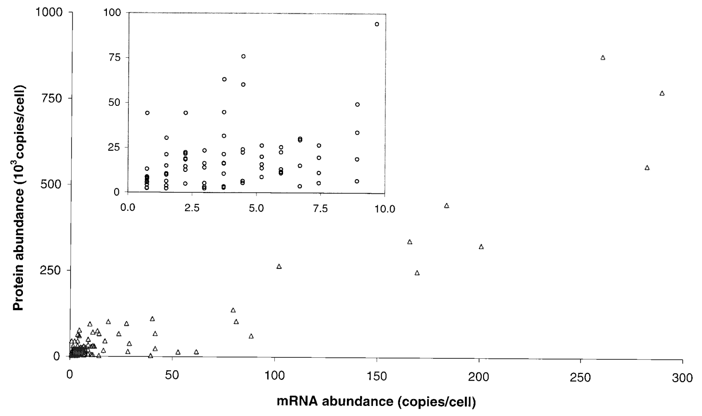
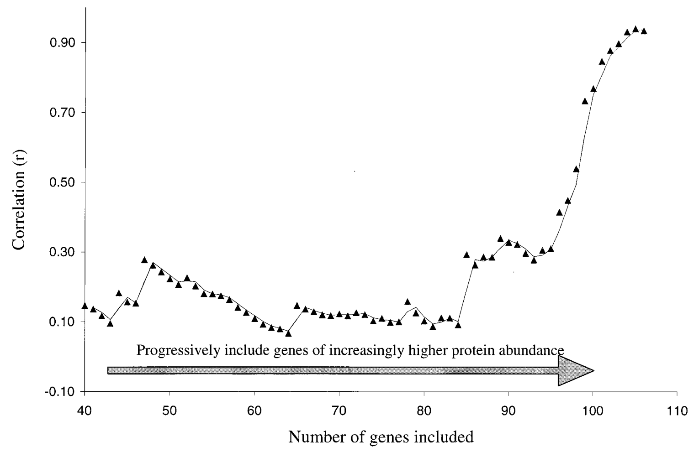
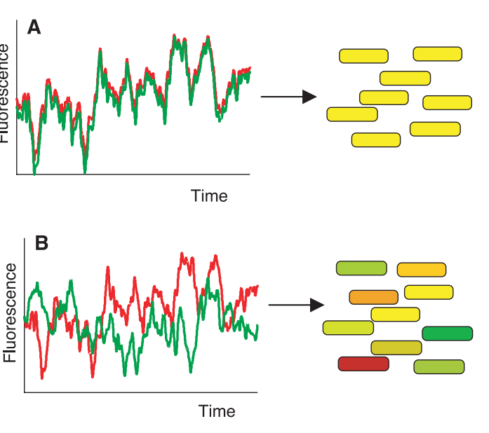
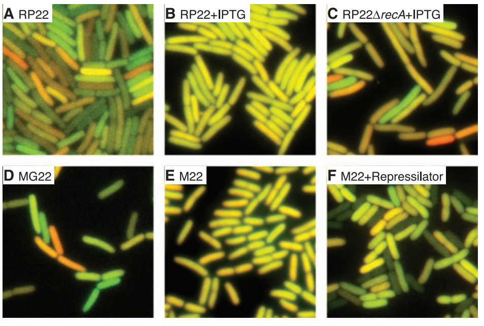
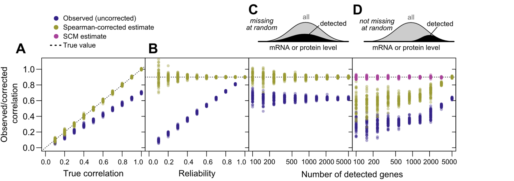
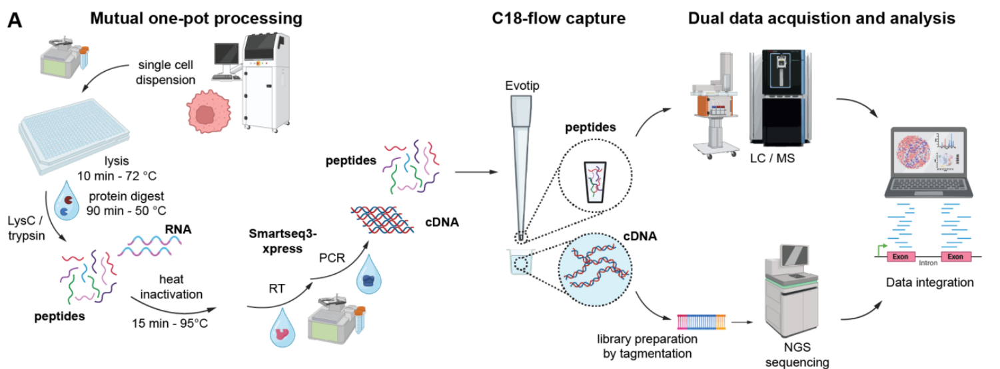
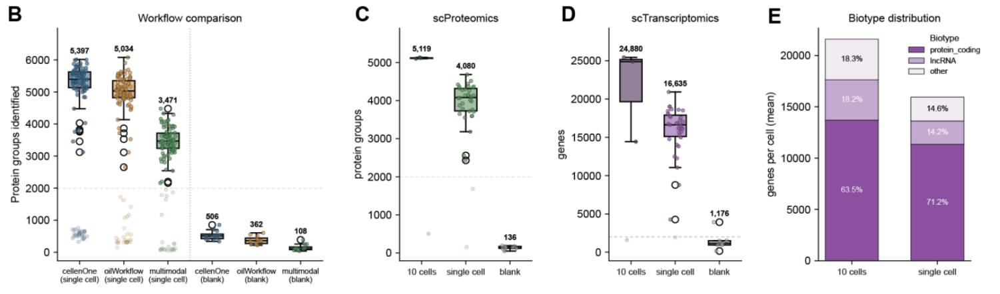
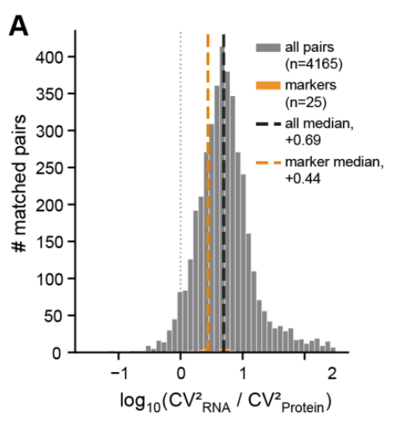

## Three different RNA–protein correlations

:::: {.columns}
::: {.column width="33%"}

Across genes

One point = one gene\
Are abundant RNAs associated with abundant proteins?
:::
::: {.column width="33%"}

Across cells

One point = one cell\
For a fixed gene, do RNA and protein fluctuate together?
:::
::: {.column width="33%"}

Across conditions

One point = one condition\
Do RNA changes predict protein changes or later responses?
:::
::::

Always ask what each point represents.

Conceptual distinctions used throughout the journal club.

::: {.notes}
Across-gene correlation captures broad abundance rankings. Within-gene across-cell correlation measures cell-to-cell covariation. Across-condition comparisons concern responses. These are different estimands. High across-gene correlation and weak within-gene correlation can coexist.

Source: Conceptual distinctions used throughout the journal club.
:::

## 1999: the abundance range changes the correlation

:::: {.columns}
::: {.column width="50%"}

:::
::: {.column width="50%"}

:::
::::

:::: {.columns}
::: {.column width="50%"}

106 genes: r = 0.935 Low-mRNA subset: r = 0.356

:::
::: {.column width="50%"}
A few highly abundant genes dominate.\
Futcher et al. also questioned measurement accuracy.
:::
::::

Gygi et al. Mol Cell Biol (1999). doi:10.1128/MCB.19.3.1720 • Figures 5 and 6

::: {.notes}
Original figures, cropped to retain axes. Protein abundance used metabolic labeling and 2D gels, with MS identification. RNA estimates came from SAGE. Across 106 genes Pearson r=0.935. The 73-gene subset below 10 mRNA copies/cell gave r=0.356. Restriction of range and measurement error both matter. Futcher et al., A Sampling of the Yeast Proteome, Mol Cell Biol 1999, doi:10.1128/MCB.19.11.7357, independently questioned low-abundance accuracy. https://pmc.ncbi.nlm.nih.gov/articles/PMC83965/

Source: Gygi et al. Mol Cell Biol (1999). doi:10.1128/MCB.19.3.1720 • Figures 5 and 6
:::

## 2002: reporter experiments separate sources of noise

:::: {.columns}
::: {.column width="38%"}

:::
::: {.column width="32%"}

:::
::: {.column width="30%"}

Shared fluctuations

Cellular conditions affect both reporters.

Independent fluctuations

Expression events can differ within the same cell.

Biological noise and measurement error need separate treatment.

:::
::::

Elowitz et al. Science (2002). doi:10.1126/science.1070919 • Figures 1 and 2

::: {.notes}
Two fluorescent reporters under equivalent control distinguish shared cellular influences (extrinsic noise) from uncorrelated reporter fluctuations (intrinsic noise). This is a protein-reporter noise experiment, not a direct RNA–protein comparison. Reporter maturation, fluorescence background and cell segmentation remain assay issues. Original figure crops. https://doi.org/10.1126/science.1070919

Source: Elowitz et al. Science (2002). doi:10.1126/science.1070919 • Figures 1 and 2
:::

## 2006: protein lifetime changes RNA–protein coupling

:::: {.columns}
::: {.column width="32%"}

:::
::: {.column width="28%"}

:::
::: {.column width="40%"}

Experiment, left

Rapidly degraded reporter: stronger coupling.\
Stable reporter: weaker coupling.

Model, center

Longer protein lifetime smooths transient RNA fluctuations.
:::
::::

Raj et al. PLoS Biol (2006). doi:10.1371/journal.pbio.0040309 • Figure 7A,B,D

::: {.notes}
RNA FISH and fluorescent reporters in mammalian cells. Figure 7A/B compares reporters with active degradation versus no active degradation. Experimental correlations are 0.78–0.84 and 0.35 respectively, under the stated reporter conditions. Panel D is a stochastic model, not additional experimental data. Its variable protein half-life illustrates temporal averaging. Do not generalize reporter behavior to all endogenous proteins. https://doi.org/10.1371/journal.pbio.0040309

Source: Raj et al. PLoS Biol (2006). doi:10.1371/journal.pbio.0040309 • Figure 7A,B,D
:::

## 2010: same-cell uncoupling without mass spectrometry

:::: {.columns}
::: {.column width="55%"}

:::
::: {.column width="45%"}

One gene across cells

tufA: r ≈ 0.01\
5,447 cells

Direct paired imaging

Protein fluorescence and RNA FISH show weak instantaneous coupling.
:::
::::

Taniguchi et al. Science (2010). doi:10.1126/science.1188308 • Figure 4

::: {.notes}
YFP fusions and single-molecule RNA FISH in E. coli. TufA-YFP r=0.01 ±0.03 SEM, n=5,447 cells. Figure 4B summarizes 129 strains selected for sufficiently small sampling error. Important limitations: bacteria, fluorescent fusions, maturation and protein lifetime. This is a strong precedent for same-cell uncoupling, not an exact replication of mammalian proteomics. https://pmc.ncbi.nlm.nih.gov/articles/PMC2922915/

Source: Taniguchi et al. Science (2010). doi:10.1126/science.1188308 • Figure 4
:::

## 2011–2014: calibration changes the inferred biology

:::: {.columns}
::: {.column width="50%"}

2011: integrated measurements

Abundance and turnover estimates support a quantitative model of gene-expression control.
:::
::: {.column width="50%"}

2013–2014: revised calibration

A correction and reanalysis shift the estimated contribution of mRNA abundance upward.
:::
::::

The biological conclusion depends on the measurement model.

Across-gene protein variance explained by mRNA is a different question from cell-to-cell coupling.

Schwanhäusser et al. Nature (2011), doi:10.1038/nature10098. Li et al. PeerJ (2014), doi:10.7717/peerj.270

::: {.notes}
Schwanhäusser combined mammalian RNA/protein abundance and turnover to estimate gene-expression control. The 2013 corrigendum revised protein abundance calibration. Li, Bickel and Biggin recalibrated using 61 individually measured housekeeping proteins and assessed further errors. Their two approaches attributed at least 56% or approximately 81% of between-gene protein variance to mRNA. These are assumption-dependent estimates, not universal constants. Sources: https://www.nature.com/articles/nature10098 and https://doi.org/10.7717/peerj.270

Source: Schwanhäusser et al. Nature (2011), doi:10.1038/nature10098. Li et al. PeerJ (2014), doi:10.7717/peerj.270
:::

## 2015: noise and missingness bias observed correlations

:::: {.columns}
::: {.column width="45%"}

Measurement reliability affects r.

:::
::: {.column width="55%"}
Correction also requires assumptions about missing values and shared errors.
:::
::::

Csárdi et al. PLoS Genet (2015). doi:10.1371/journal.pgen.1005206 • Figure 3 (simulations)

::: {.notes}
Figure 3 is simulated evidence evaluating correlation estimators, not the empirical yeast result. Independent measurement error attenuates correlation. Missingness related to abundance complicates correction. Using 24 yeast studies, the paper estimated >85% of between-gene steady-state protein variance explained by mRNA after correction. Estimates depend on the covariance and missing-data model. https://doi.org/10.1371/journal.pgen.1005206

Source: Csárdi et al. PLoS Genet (2015). doi:10.1371/journal.pgen.1005206 • Figure 3 (simulations)
:::

## 2026: deep RNA and protein measurements from one cell

Paired cell identity is the central technical strength.

Models: asynchronous HeLa cells and mouse ESC pluripotency transitions.

Thielert et al. bioRxiv v1 (2026). doi:10.64898/2026.08.25.746940 • Figure 1A

::: {.notes}
Current supplied preprint, posted 26 August 2026, not peer reviewed. Full title: In the same cell, the proteome defines cellular state and the transcriptome marks transitions. Digestion precedes reverse transcription and PCR. C18 retains peptides while cDNA passes through. This preserves paired cell identity without simply halving the crude lysate. Same-cell design removes unmatched-cell ambiguity but does not calibrate either assay. Original figure crop.

Source: Thielert et al. bioRxiv v1 (2026). doi:10.64898/2026.08.25.746940 • Figure 1A
:::

## Depth establishes coverage, not quantitative accuracy

:::: {.columns}
::: {.column width="50%"}

Benchmark: 4,080 protein groups and 16,635 detected genes per cell

:::
::: {.column width="50%"}
What is still needed?\
Known-input recovery and error estimates at single-cell input.
:::
::::

Thielert et al. bioRxiv v1 (2026). doi:10.64898/2026.08.25.746940 • Figure 1B–E

::: {.notes}
Figure 1B median multimodal depth 3,471 protein groups per cell vs 5,397 and 5,034 in standalone workflows. Independent benchmark C/D reaches medians of 4,080 protein groups and 16,635 read-aligned detected genes. These are benchmark-specific values. Numbers of identifications, blank controls, accuracy of fold changes and precision are distinct performance dimensions. Depth does not validate the variance estimate.

Source: Thielert et al. bioRxiv v1 (2026). doi:10.64898/2026.08.25.746940 • Figure 1B–E
:::

## The comparison axis explains apparently conflicting r values

:::: {.columns}
::: {.column width="50%"}

Across genes: broad abundance ranking

:::
::: {.column width="50%"}

Across cells: median per-gene r = 0.038

:::
::::

Thielert et al. bioRxiv v1 (2026). doi:10.64898/2026.08.25.746940 • Figure S3B–D

::: {.notes}
318 HeLa cells. Within a cell across genes median r=0.45 (Figure 2A). Cell-averaged abundance across genes r≈0.55 (S3B). Within gene across cells median r=0.038 (S3C). Pooled z-scored pairs r=0.046 (S3D). Do not compare 0.45 and 0.038 as if one were a failed replication of the other. Same-cell matching does not eliminate measurement error or temporal integration.

Source: Thielert et al. bioRxiv v1 (2026). doi:10.64898/2026.08.25.746940 • Figure S3B–D
:::

## State markers retain stronger RNA–protein coupling

:::: {.columns}
::: {.column width="50%"}

Curated markers: median r = 0.32 All matched pairs: median r = 0.044

:::
::: {.column width="50%"}
RNA-only changes are frequent in pairwise state comparisons.\
Detection and power differ by modality.
:::
::::

Thielert et al. bioRxiv v1 (2026). doi:10.64898/2026.08.25.746940 • Figure 3H,I

::: {.notes}
Mouse ESCs progress through naive, formative 6 h, formative 48 h and primed conditions. Global matched-pair median r=0.044 versus 0.32 for 32 curated marker pairs (Figure 3F). Panel H contains per-gene scaled means and detection fractions, not absolute RNA–protein abundance comparisons. Panel I uses pairwise state contrasts with fold-change and significance cutoffs. Those classifications differ from pseudotime tests in Figure 4.

Source: Thielert et al. bioRxiv v1 (2026). doi:10.64898/2026.08.25.746940 • Figure 3H,I
:::

## Only one-third of pairs change synchronously along pseudotime

:::: {.columns}
::: {.column width="50%"}

Strong evidence of complementary patterns

:::
::: {.column width="50%"}
The timing is inferred from different cells.\
A pseudotime bin is not a measured delay.
:::
::::

Thielert et al. bioRxiv v1 (2026). doi:10.64898/2026.08.25.746940 • Figure 4A–C

::: {.notes}
3,674 matched genes classified across five equal-count pseudotime bins. 33% synchronous. RNA leads 8%, protein leads 4.5%, protein-only 23%, RNA-only 8.7%, inverted 7.7%, compound 9.3%, stable 6.2%. Pseudotime orders different cells and does not directly measure a molecular time delay in an individual cell. Results depend on binning, significance and trajectory construction. Avoid comparing these classes directly with Figure 3I pairwise tests.

Source: Thielert et al. bioRxiv v1 (2026). doi:10.64898/2026.08.25.746940 • Figure 4A–C
:::

## The key variance claim: RNA CV² is 4.9-fold higher

:::: {.columns}
::: {.column width="40%"}

:::
::: {.column width="60%"}

Reported observation

Protein has lower measured relative variability within states.

Biological interpretation

Longer protein lifetimes buffer RNA fluctuations.

How much of the gap survives assay calibration?

:::
::::

Thielert et al. bioRxiv v1 (2026). doi:10.64898/2026.08.25.746940 • Figure 5A

::: {.notes}
4,165 matched pairs with finite within-condition CV². Figure reports median log10 ratio +0.69, corresponding to 4.9-fold. State-marker median +0.44 corresponds to 2.8-fold. CV² is relative variance, not raw variance or standard deviation. Methods state measured, unimputed protein values with >=15 detected cells per state. Detection-conditioned variance can still differ from variance in the full population. Exact raw versus transformed layer for this calculation merits code verification.

Source: Thielert et al. bioRxiv v1 (2026). doi:10.64898/2026.08.25.746940 • Figure 5A
:::

## Fewer cells recover the proteome's own PCA structure

:::: {.columns}
::: {.column width="50%"}

80% recovery: 110 versus 345 cells

:::
::: {.column width="50%"}
Different reference dimensionalities\
Model uncertainty needs external validation
:::
::::

Thielert et al. bioRxiv v1 (2026). doi:10.64898/2026.08.25.746940 • Figure 5B,C

::: {.notes}
Figure 5B uses 495 matched cells and 1,742 pairs detected in >=80% of cells. It recovers each modality's own component count at a 30% explained-variance threshold: 6 full-sample protein PCs vs 26 RNA PCs. 80% recovery at 110 protein cells vs 345 RNA cells. This is not a common externally validated classification endpoint. Figure 5C shows model-based pseudotime uncertainty (median sigma 0.0036 protein vs 0.0212 RNA), not independent ground-truth accuracy.

Source: Thielert et al. bioRxiv v1 (2026). doi:10.64898/2026.08.25.746940 • Figure 5B,C
:::

## Precision, accuracy and biological variance

Observed signal = response to true abundance + error

:::: {.columns}
::: {.column width="33%"}

Precision

Repeatability at fixed input.\
Random error usually adds variance.
:::
::: {.column width="33%"}

Accuracy

Recovery of known abundance differences.\
Bias can persist across precise repeats.
:::
::: {.column width="33%"}

Biological variance

Cell-to-cell variation after accounting for assay response and error.
:::
::::

Low measured variance alone cannot establish accurate measurement.

Statistical framework for discussion. Classical independent additive-error assumptions are stated below.

::: {.notes}
Let observed Y=a+bX+epsilon. With error independent of X, Var(Y)=b² Var(X)+Var(epsilon). Compression (b<1) can reduce variance, additive error increases it. CV is invariant to multiplicative scaling alone, but not offsets, nonlinear transforms or censoring. Classical attenuation: r_obs=r_true sqrt(R_RNA R_protein), where R is reliability, under independent errors and a linear additive model. Correlated errors violate this simple expression. These are conceptual models, not fitted results from this preprint.

Source: Statistical framework for discussion. Classical independent additive-error assumptions are stated below.
:::

## The critique must follow the actual analysis

:::: {.columns}
::: {.column width="50%"}

What the paper states

CV² uses detected, unimputed values.\
At least 15 cells per state are required.
:::
::: {.column width="50%"}

What needs verification

Exact scale for CV².\
RNA read counts versus UMI counts.\
Sensitivity to detection thresholds.
:::
::::

Imputation is relevant to embeddings and latent structure, but it is not the direct explanation for Figure 5A.

Thielert et al. bioRxiv v1 (2026). doi:10.64898/2026.08.25.746940 • Methods pp. 26–28 and Figure 5

::: {.notes}
Important correction to a generic imputation critique: CV and CV² use unimputed protein values. Missingness and filtering still matter. Generic preprocessing describes log2 protein intensities and log1p RNA counts normalized to 10,000 per cell. The variance paragraph does not unambiguously name the exact raw/transformed layer. Source code inspection would be required to establish this; do not claim log-CV misuse as demonstrated. RNA counts are read-aligned unless stated otherwise, so UMI-based sensitivity analysis is relevant. Embeddings use imputation/batch correction, with different workflows for the two modalities.

Source: Thielert et al. bioRxiv v1 (2026). doi:10.64898/2026.08.25.746940 • Methods pp. 26–28 and Figure 5
:::

## Experiments that separate stability from assay behavior

:::: {.columns}
::: {.column width="50%"}

Known input

Cell-equivalent lysate replicates and early standards estimate technical error.
:::
::: {.column width="50%"}

Known differences

Controlled mixtures and dilution series test linearity and fold-change recovery.
:::
::::

:::: {.columns}
::: {.column width="50%"}

Robust analysis

Matched features, detection strata, raw-scale checks and UMI sensitivity.
:::
::: {.column width="50%"}

Independent endpoint

Orthogonal assays and held-out state labels test accuracy beyond PCA recovery.
:::
::::

Proposed validation experiments and sensitivity analyses.

::: {.notes}
These are suggested controls, not claims that the authors performed them. Homogeneous lysate aliquots quantify preparation and acquisition variability at a fixed input but omit sorting and lysis variation. Standards introduced early can probe more of the workflow. Controlled mixtures assess fold-change recovery and interference. Orthogonal protein measurements have their own error sources. The cleanest modality comparison uses a shared externally validated biological endpoint.

Source: Proposed validation experiments and sensitivity analyses.
:::

## Discussion: what does the evidence establish?

Same-cell profiling reveals complementary RNA and protein patterns.

Lower measured protein CV² is consistent with biological buffering.

How much of the difference comes from assay response, detection and analysis?

Which single control would most change your confidence?

Thielert et al. bioRxiv v1 (2026). doi:10.64898/2026.08.25.746940; historical sources on following slides.

::: {.notes}
Invite the audience to distinguish observation, mechanism and generalization. The preprint is technically strong for same-cell depth and demonstrates complementary observed patterns. Protein buffering is plausible and supported by older reporter experiments. Universal superiority for cell-state definition is a broader claim requiring fair measurement comparisons and a shared validation target.

Source: Thielert et al. bioRxiv v1 (2026). doi:10.64898/2026.08.25.746940; historical sources on following slides.
:::

## References: history and measurement

**Gygi et al. (1999)** Correlation between protein and mRNA abundance in yeast\
10.1128/MCB.19.3.1720

**Futcher et al. (1999)** A sampling of the yeast proteome\
10.1128/MCB.19.11.7357

**Elowitz et al. (2002)** Stochastic gene expression in a single cell\
10.1126/science.1070919

**Raj et al. (2006)** Stochastic mRNA synthesis in mammalian cells\
10.1371/journal.pbio.0040309

**Taniguchi et al. (2010)** Quantifying E. coli proteome and transcriptome with single-molecule sensitivity in single cells\
10.1126/science.1188308

Original paper figures retain panel labels. Sources and interpretation notes accompany each slide.

::: {.notes}
Figure assets come from original PDFs. Gygi: https://proteome.gs.washington.edu/classes/Genome490/papers/Gygi_et_al_Mol_Cell_1999.pdf; Elowitz: https://www.dna.caltech.edu/cbsss/pdf/ElowitzM/Noise.pdf; Raj: https://journals.plos.org/plosbiology/article?id=10.1371/journal.pbio.0040309; Taniguchi: https://pmc.ncbi.nlm.nih.gov/articles/PMC2922915/; Csardi: https://doi.org/10.1371/journal.pgen.1005206

Source: Original paper figures retain panel labels. Sources and interpretation notes accompany each slide.
:::

## References: calibration and the current preprint

**Schwanhäusser et al. (2011)** Global quantification of mammalian gene expression control. Nature.\
10.1038/nature10098 (correction in 2013)

**Li, Bickel & Biggin (2014)** System wide analyses have underestimated protein abundances and the importance of transcription in mammals. PeerJ.\
10.7717/peerj.270

**Csárdi et al. (2015)** Accounting for experimental noise reveals that mRNA levels, amplified by post-transcriptional processes, largely determine steady-state protein levels in yeast.\
10.1371/journal.pgen.1005206

**Thielert et al. (2026)** In the same cell, the proteome defines cellular state and the transcriptome marks transitions. bioRxiv v1\
10.64898/2026.08.25.746940

The supplied preprint is version 1, posted 26 August 2026, and has not been peer reviewed.

::: {.notes}
Current source: Thielert et al., bioRxiv v1, posted 26 August 2026 (2026.08.25.746940v1.full.pdf). Citation URLs use DOI resolvers. Original panels were cropped from the supplied source without changing data. Preprint figure attribution: Thielert et al., CC-BY-NC-ND 4.0. Raj and Csardi figures are from PLOS open-access articles. Other paper figures are reproduced with attribution for journal-club discussion.

Source: The supplied preprint is version 1, posted 26 August 2026, and has not been peer reviewed.
:::
